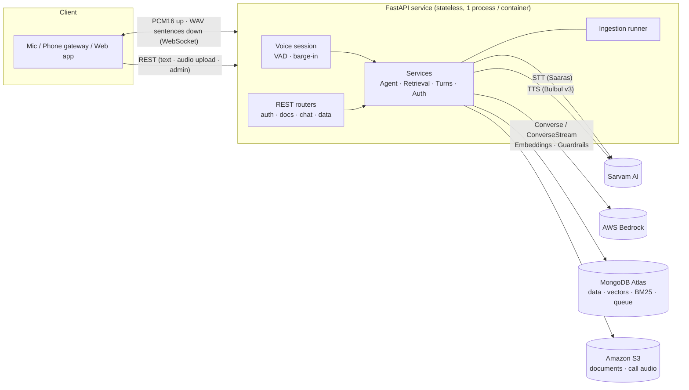

# Voice Support Agent

**A production-grade, real-time AI voice customer-support backend for e-commerce and pharmacy platforms.**
Callers speak; the agent understands (Sarvam *Saaras* STT), retrieves grounded answers from enterprise documents and business data (RAG on AWS Bedrock + MongoDB Atlas), takes actions through tools (order lookup, catalogue, human hand-off), and answers out loud (Sarvam *Bulbul v3* TTS) — streaming the first sentence of audio while the rest is still being generated.

   

---

## Why this exists — use cases

| Vertical | What callers ask | What the agent does |
|---|---|---|
| **E-commerce** | "Where is my order ORD-1001?", "How long do refunds take?", "Is the keyboard in stock?" | Looks up the caller's own orders (tenant- and customer-scoped), answers policy questions from uploaded documents with citations, checks catalogue price/stock, hands off to a human when it can't help |
| **Pharmacy** | "What are the storage instructions?", "Do I need a prescription for this?", "I felt dizzy after taking it" | Answers only from approved leaflets/policies, checks `requires_prescription`, **never** gives diagnoses or personal dosing, records adverse-event reports as escalations, and short-circuits medical emergencies with a deterministic safety response (no LLM in the loop) |

Customers speak **English or any of 10 Indian languages** (Hindi, Bengali, Tamil, Telugu, Kannada, Malayalam, Marathi, Gujarati, Punjabi, Odia); the agent replies in the same language and voice.

## Highlights

- **Real-time voice over WebSocket** — server-side VAD end-pointing, sentence-level streaming TTS (parallel synthesis, strictly ordered delivery), **barge-in** (caller interrupts, the reply is cancelled and the partial answer kept in history).
- **Hybrid RAG** — Bedrock embeddings (Titan V2 / Cohere multilingual) → MongoDB Atlas **Vector Search + BM25** in one collection, fused with Reciprocal Rank Fusion, metadata pre-filters (category, tags, SKUs, language), follow-up query rewriting, similarity floor so it *abstains instead of hallucinating*.
- **Tool-using agent** on the Bedrock **Converse API** (streaming + tool use + optional **Bedrock Guardrails**): `get_order_status`, `search_catalog`, `search_knowledge_base`, `escalate_to_human`.
- **Multi-tenant by construction** — every query is tenant-scoped (including the vector pre-filter); JWT access/refresh with **rotation + reuse detection**, Argon2id, RBAC (`admin` / `editor` / `customer`), per-user and per-IP rate limits shared across replicas.
- **Document ingestion pipeline** — PDF, DOCX, Markdown, HTML, CSV, JSON, TXT → section-aware chunking → embeddings → index. MongoDB-backed job queue with leases, retries and crash recovery; runs in-process or as a separate worker (`python -m app.worker`).
- **Privacy & safety** — Luhn-validated card-number redaction before storage/LLM, PII-masked structured logs, prompt-injection-aware prompt design, SSE-encrypted S3, conversation TTL + hard-delete (audio included), audit trail.
- **Operability** — structured JSON logs with request-ID correlation, Prometheus metrics (per-stage voice latency, token usage, ingestion, escalations), liveness/readiness probes, graceful degradation (LLM outage ⇒ spoken apology; TTS failure ⇒ text still delivered; Atlas Search outage ⇒ vector-only).
- **Quality gates** — 94 automated tests, ruff-clean, GitHub Actions CI (3 Python versions + container smoke test), multi-stage non-root Dockerfile, compose stack with Atlas Local and MinIO.

## Architecture



Layering (dependencies point inward; adapters implement the Protocols in [`app/ports.py`](app/ports.py)):

```
api/  (FastAPI routers, schemas, deps)  →  services/  (agent, retrieval, turns, voice, auth …)
                                              ↓ depends on Protocols only
        integrations/ (Bedrock, Sarvam, S3)   repositories/ (MongoDB, Atlas Search)
```

See **[docs/ARCHITECTURE.md](docs/ARCHITECTURE.md)** for sequence diagrams, the data model, latency budget, failure modes and design decisions.

## Tech stack

| Concern | Choice |
|---|---|
| Language / web | Python 3.11+, FastAPI, Uvicorn, Pydantic v2 (fully async) |
| LLM + embeddings | **AWS Bedrock** — Claude via Converse/ConverseStream (tool use), Titan Text Embeddings V2 or Cohere Embed Multilingual |
| Speech | **Sarvam AI** — Saaras (STT) and **Bulbul v3** (TTS) |
| Documents & audio | **Amazon S3** (SSE-S3 / SSE-KMS, presigned URLs) |
| Data + vectors | **MongoDB** (PyMongo Async API) with Atlas Vector Search + Atlas Search |
| Auth | JWT (PyJWT), Argon2id (argon2-cffi) |
| Observability | structlog, prometheus-client |
| Packaging | Docker (multi-stage, non-root), docker-compose, GitHub Actions |

## Quick start

### 1. Prerequisites (external services — these are real integrations)

1. **AWS**: enable Bedrock model access for your chosen Claude and embedding models in your region, and make AWS credentials available (env vars, `~/.aws` profile, or an IAM role). Minimal IAM policy: [`infra/iam-policy.json`](infra/iam-policy.json).
2. **Sarvam AI**: create an API key at <https://dashboard.sarvam.ai>.
3. **MongoDB with Atlas Search + Vector Search**: an Atlas cluster, or the bundled `mongodb-atlas-local` container for development.
4. **S3 bucket**: AWS S3, or the bundled MinIO container for development.

### 2. Run locally with Docker

```bash
cp .env.example .env            # set SARVAM_API_KEY, JWT_SECRET, AWS_REGION / model IDs
docker compose up --build       # api + MongoDB Atlas Local + MinIO
open http://localhost:8000/docs # interactive OpenAPI
```

### 3. Seed a demo tenant and try it

```bash
pip install -e ".[dev]"
python scripts/seed_demo.py --vertical ecommerce   # tenant, customer login, docs, orders, catalogue

# Ask a question by text (and get the spoken reply back as base64 WAV)
TOKEN=$(curl -s localhost:8000/v1/auth/login -H 'content-type: application/json' \
  -d '{"email":"customer-ecommerce@demo.example.com","password":"demo-password-123"}' | jq -r .access_token)
CONV=$(curl -s -X POST localhost:8000/v1/conversations -H "Authorization: Bearer $TOKEN" \
  -H 'content-type: application/json' -d '{"language":"en-IN","speaker":"priya"}' | jq -r .id)
curl -s -X POST localhost:8000/v1/conversations/$CONV/messages -H "Authorization: Bearer $TOKEN" \
  -H 'content-type: application/json' -d '{"text":"Where is my order ORD-1001?","speak":true}' | jq 'del(.audio.base64)'

# Real-time voice from the terminal (streams a 16 kHz mono WAV, saves reply_*.wav)
pip install websockets
python scripts/voice_client.py --email customer-ecommerce@demo.example.com --password demo-password-123 --wav question.wav
```

### 4. Run without Docker

```bash
python -m venv .venv && source .venv/bin/activate && make install
cp .env.example .env            # point MONGODB_URI / S3_* at your services
make run                        # uvicorn --reload on :8000
```

## API at a glance

Full reference with request/response examples: **[docs/API.md](docs/API.md)** (also live at `/docs`).

| Area | Endpoints |
|---|---|
| Auth | `POST /v1/auth/{signup,login,refresh,logout,change-password}` · `GET /v1/auth/me` |
| Users & tenant | `POST/GET /v1/users` · `PATCH /v1/users/{id}` · `GET/PATCH /v1/tenant` |
| Knowledge base | `POST/GET /v1/documents` · `GET/PATCH/DELETE /v1/documents/{id}` · `POST /v1/documents/{id}/reindex` · `POST /v1/knowledge/search` |
| Conversations | `POST/GET /v1/conversations` · `GET /v1/conversations/{id}/messages` · `POST …/messages` (text) · `POST …/voice` (audio upload) · `DELETE …` |
| **Realtime** | **`WS /v1/ws/voice`** — streaming voice with VAD and barge-in |
| Business data | `PUT /v1/orders` · `GET /v1/orders/{id}` · `PUT/GET/DELETE /v1/catalog/items` |
| Operations | `GET/PATCH /v1/escalations` · `GET /v1/analytics/summary` · `GET /v1/audit-log` |
| Health | `GET /healthz` · `GET /readyz` · `GET /metrics` |

### Realtime protocol (summary)

```
client → {"type":"start","token":"<JWT>","language":"en-IN","speaker":"priya"}      server → {"type":"ready",…}
client → <binary PCM16 mono frames>                                                 server → {"type":"vad","state":"speech_start"}
                                                                                    server → {"type":"transcript","text":"…"}
                                                                                    server → {"type":"audio","index":0,"text":"First sentence."} + <binary WAV>
client → {"type":"interrupt"}  (or just start talking)                              server → {"type":"interrupted"}
                                                                                    server → {"type":"turn_complete","citations":[…],"latency":{…}}
```

## Configuration

Everything is environment-driven and validated at startup (`app/core/config.py`); staging/production **refuse to boot** with a weak `JWT_SECRET`, a missing `SARVAM_API_KEY` or wildcard CORS. See [`.env.example`](.env.example) for every variable. Model IDs are settings, not code: use the inference-profile IDs enabled in *your* account/region.

## Testing

```bash
make test        # 94 tests, ~20 s, no network or credentials required
make lint        # ruff check + format --check
```

The suite runs the **real** FastAPI app, repositories, services, ingestion pipeline, agent loop and WebSocket sessions. Only the four external systems are replaced by test doubles (`tests/fakes.py`): Bedrock, Sarvam, S3 and Atlas Search; MongoDB is emulated with `mongomock`. Adapter tests assert the **exact wire formats** sent to those services (Converse/ConverseStream payloads, tool-use assembly, Titan/Cohere bodies, Sarvam multipart/JSON, `$vectorSearch`/`$search` pipelines, index definitions).

> **Verification status.** CI cannot call live AWS/Sarvam/Atlas. Before going live, run the checklist in [docs/DEPLOYMENT.md](docs/DEPLOYMENT.md#go-live-verification-checklist): confirm Bedrock model access, wait for both Atlas search indexes to become *queryable*, run `scripts/seed_demo.py`, then `scripts/voice_client.py` end to end.

## Project layout

```
app/
  main.py · container.py · worker.py · ports.py       app factory · DI container · ingestion worker · interfaces
  core/          config, logging, security (JWT/Argon2), errors, metrics, middleware, PII
  domain/        enums, Pydantic models, language/voice catalogue
  integrations/  bedrock_llm · bedrock_embeddings · sarvam (STT/TTS) · s3_storage
  repositories/  MongoDB repos, Atlas vector/BM25 chunk store, index management
  ingestion/     parsers (PDF/DOCX/MD/HTML/CSV/JSON) · chunker · job runner
  services/      agent · tools · prompts · retrieval · turns · voice · voice_session · vad · segmenter · auth …
  api/           deps, schemas, v1 routers (auth, documents, conversations, business, ops, voice_ws, health)
tests/           unit · API end-to-end · WebSocket · adapter wire-format tests
docs/            ARCHITECTURE · API · DEPLOYMENT · SECURITY
infra/           IAM policy, S3 lifecycle rule
scripts/         seed_demo.py · voice_client.py
samples/         sample policies, leaflets, orders, catalogue (e-commerce + pharma)
```

## Known limitations & roadmap

- **STT is per-utterance REST** (≤ 30 s), triggered by VAD/commit. Lowest-latency next step: Sarvam's streaming STT WebSocket (the `SpeechToText` port makes this a drop-in adapter).
- Scanned/image-only PDFs need OCR (Amazon Textract hook point in `ingestion/parsers.py`); not enabled.
- Server-side VAD is energy-based; for noisy lines use client-side VAD or swap in Silero VAD behind `UtteranceDetector`.
- Telephony (SIP/Twilio/Exotel) is out of scope: connect a media gateway that forwards 16 kHz PCM to the WebSocket.
- Rate limiting is fixed-window; swap `RateLimiter` for a sliding window/Redis if you need stricter fairness.

## Security

See **[docs/SECURITY.md](docs/SECURITY.md)** for the threat model, controls, data-retention guidance and responsible-disclosure notes. Pharma deployments: this software provides *information from approved labelling only* and is not a medical device; have your regulatory/medical-safety team review prompts, escalation handling and retention before launch.

## License

MIT — see [LICENSE](LICENSE).
